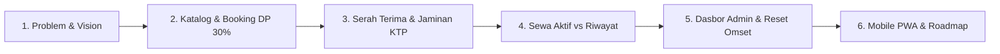
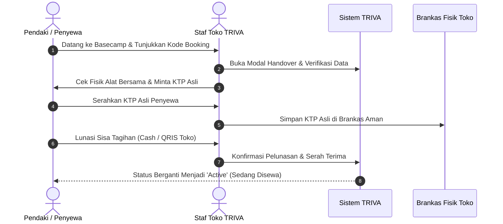
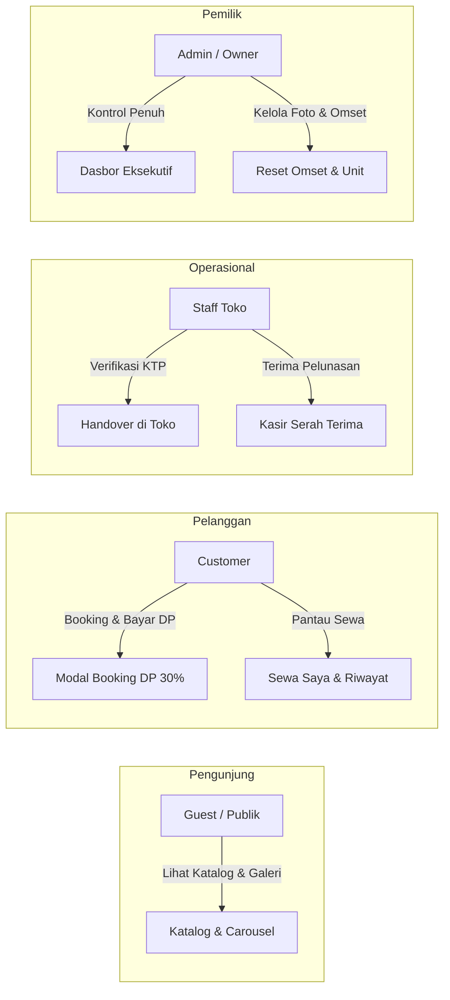
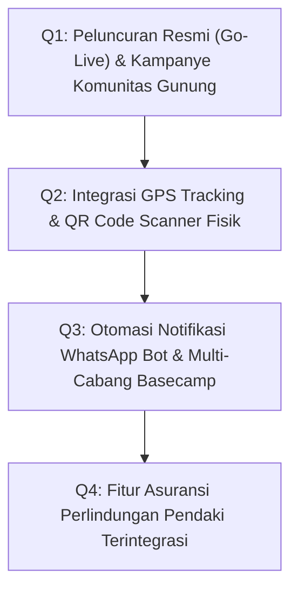

# Panduan & Materi Presentasi Aplikasi TRIVA Outdoor Rental
## Tema: *"Style on the Trail — Modernisasi Bisnis Persewaan Alat Outdoor Berbasis SaaS & Mobile PWA"*

---

> [!NOTE]
> **Panduan Presenter:**
> Dokumen ini dirancang sebagai panduan presentasi komprehensif yang telah diselaraskan 100% dengan **Product Requirement Document (PRD) TRIVA Outdoor Rental v2.1**. Setiap slide dilengkapi dengan **Tangkapan Layar Nyata Aplikasi**, **Poin Kunci (Key Takeaways)**, dan **Naskah Presenter (Script Apa yang Harus Diucapkan)** agar Anda dapat membawakan presentasi dengan percaya diri, profesional, dan meyakinkan di hadapan audiens, stakeholder, penguji, maupun investor.

---



---

## Slide 1: Pembuka & Brand Identity


- **Judul Slide:** TRIVA Outdoor Rental — Style on the Trail
- **Sub-judul:** Platform Digital Manajemen Persewaan Alat Pendakian Modern, Andal, dan Terintegrasi
- **Presenter:** Tim Pengembang TRIVA Outdoor / Rifki Apirin
- **Platform:** Web Responsive & Mobile Progressive Web App (PWA)

### Poin Utama:
1. TRIVA bukan sekadar tempat sewa alat, melainkan solusi gaya hidup petualangan outdoor dengan standar estetika dan keamanan tinggi.
2. Memperkenalkan identitas brand *"Style on the Trail"* dengan palet warna Crimson Mountain (`#851919`) dan Forest Dark (`#0f172a`).
3. Tampilan Hero interaktif dengan model 3D Jacket Hardshell dan status ketersediaan harga transparan per hari.

> [!TIP]
> **Naskah Presenter (Script Ucapan):**
> *"Selamat pagi / siang rekan-rekan dan bapak/ibu sekalian. Hari ini saya bangga mempersembahkan TRIVA Outdoor Rental dengan tagline 'Style on the Trail'. Di era di mana aktivitas mendaki gunung dan berkemah telah menjadi bagian dari gaya hidup generasi muda, bisnis persewaan outdoor membutuhkan transformasi digital yang tidak hanya fungsional, tetapi juga memberikan pengalaman pengguna yang estetik, cepat, dan terpercaya. Inilah alasan mengapa kami membangun TRIVA Outdoor Rental."*

---

## Slide 2: Latar Belakang Masalah & Solusi Bisnis


- **Judul Slide:** Latar Belakang: 4 Masalah Klasik Rental Outdoor & Solusi TRIVA
- **Fokus:** Mengapa sistem manual toko sewa konvensional harus ditinggalkan.

### 4 Masalah Utama Industri Rental Outdoor:
1. **Risiko Kehilangan & Kerusakan Alat:** Toko konvensional seringkali lupa menahan jaminan identitas asli atau tidak memiliki catatan kondisi fisik alat saat serah terima.
2. **Pencatatan Keuangan Tidak Rapi:** Uang muka (DP), sisa pelunasan di toko, dan denda keterlambatan kerap tercampur di buku kas fisik tanpa rekonsiliasi digital.
3. **Pemesanan Tidak Real-Time:** Pelanggan harus datang ke toko atau chat berulang kali hanya untuk menanyakan ketersediaan tenda atau carrier.
4. **Citra Brand yang Usang:** Kurangnya media kurasi visual yang membangun kepercayaan para pendaki pemula maupun profesional.

### Solusi TRIVA:
- Sistem terintegrasi dengan **Katalog Unit Berkode Unik** (`TND-01`, `CR-01`, dll.).
- Otomasi pembayaran **DP minimal 30% via QRIS** dan pelunasan saat serah terima di toko.
- Pengelolaan jaminan **KTP fisik** terstandarisasi di brankas toko.
- Dasbor eksekutif dengan data omset realtime dan pelaporan akuntansi digital.

> [!TIP]
> **Naskah Presenter (Script Ucapan):**
> *"Bapak/Ibu sekalian, bisnis sewa alat outdoor konvensional memiliki kerentanan besar: alat hilang karena jaminan tidak tertib, kas DP dan pelunasan toko tercecer di buku tulis, serta calon pendaki yang kecewa karena alat habis saat tiba di basecamp. TRIVA Outdoor Rental memecahkan seluruh masalah ini. Melalui katalog kategori terstruktur yang Anda lihat di layar—mulai dari Tenda Dome, Carrier Ergonomis, hingga Peralatan Memasak—semua unit terdata secara realtime sehingga pelanggan tahu persis ketersediaan alat sebelum menyewa."*

---

## Slide 3: Galeri Komunitas #StyleOnTheTrail (UGC Nyata)


- **Judul Slide:** Social Proof & Komunitas: Galeri #StyleOnTheTrail
- **Fokus:** Membangun *brand trust* melalui foto petualangan pendaki asli di gunung-gunung Indonesia.

### Fitur Kunci Galeri:
1. **Foto Lapangan Nyata:** Dokumentasi nyata pendakian di Gunung Gede (2.958 MDPL), Gunung Sagara (2.132 MDPL), Hutan Mati Papandayan, Gunung Cikuray, dan Gunung Prau.
2. **Role-Based Access Control (RBAC):** Tombol *"Ganti Foto"* dan *"Simpan Foto Galeri"* hanya dapat diakses oleh peran `admin/owner`, sementara penyewa umum hanya dapat melihat dan memberikan *Love/Like*.
3. **Teknologi Kompresi Anti-Reset:** 
   - Dilengkapi modul kompresi otomatis HTML5 Canvas di sisi klien untuk mereduksi foto resolusi tinggi kamera HP (dari 5MB–10MB menjadi ~90KB) tanpa mengurangi ketajaman visual.
   - Disimpan secara berlapis di `IndexedDB`, `localStorage`, dan sinkronisasi server, menjamin foto **tidak akan hilang atau kembali ke default saat di-refresh**.

> [!TIP]
> **Naskah Presenter (Script Ucapan):**
> *"Kepercayaan pelanggan outdoor dibangun lewat bukti nyata di lapangan. Pada layar ini, kita melihat Galeri Komunitas #StyleOnTheTrail yang menampilkan foto-foto pendaki asli menggunakan perlengkapan kami di Puncak Gede, Gunung Sagara, dan Hutan Mati Papandayan. Khusus untuk pemilik toko, sistem menyediakan fitur ganti foto interaktif dengan teknologi kompresi otomatis client-side. Gambar dikompresi seketika agar hemat penyimpanan dan diproteksi dengan penyimpanan berlapis sehingga galeri tetap permanen dan tidak pernah kembali ke bawaan saat halaman diperbarui."*

---

## Slide 4: Layanan Pelanggan Responsif (Floating WhatsApp CS)


- **Judul Slide:** Layanan Pelanggan Instan: Hotline WhatsApp Mengambang
- **Fokus:** Jalur komunikasi cepat antara calon pendaki dan admin operasional.

### Karakteristik Desain & Fungsionalitas:
- **Hotline Resmi Terintegrasi:** Terhubung langsung ke WhatsApp Admin di nomor `083851284143` (`+62 838-5128-4143`).
- **Ergonomi UI:** Penempatan cerdas (`bottom-20 right-4` di layar smartphone) agar tombol tidak menutupi *bottom navigation bar* HP.
- **Quick Chips (Tombol Pertanyaan Instan):**
  - *"Konfirmasi Pembayaran DP / Pelunasan"*
  - *"Kendala Serah Terima Alat"*
  - *"Tanya Ketersediaan / Booking Khusus"*
- **Format Pesan Otomatis:** Menghasilkan template pesan WhatsApp yang rapi dan terstruktur begitu pelanggan mengklik tombol kirim.

> [!TIP]
> **Naskah Presenter (Script Ucapan):**
> *"Kami memahami bahwa pendaki sering membutuhkan konsultasi cepat sebelum berangkat: apakah tenda ini tahan badai? Bagaimana cara konfirmasi DP? Untuk itu, TRIVA menyematkan Floating WhatsApp Widget di seluruh halaman. Dilengkapi tombol opsi instan atau Quick Chips, pengguna cukup satu kali klik untuk membuka obrolan langsung ke WhatsApp Admin di 083851284143 dengan pesan yang sudah terformat rapi. Posisi tombol juga telah dioptimasi secara ergonomis agar nyaman dioperasikan satu tangan pada perangkat ponsel."*

---

## Slide 5: Manajemen Inventaris & Pelacakan Unit Alat


- **Judul Slide:** Manajemen Inventaris Cerdas: Kodefikasi Unit & Status Realtime
- **Fokus:** Kontrol aset alat sewa secara individual untuk mencegah *overbooking*.

### Standar Kodefikasi Alat:
- Setiap unit fisik memiliki identitas unik:
  - `TND-01`: Tenda Dome Borneo 4 Orang (Kap. 4 Orang, Waterproof 3000mm)
  - `CR-01`: Carrier Eiger Rhinos 60L (Ergonomic Backsystem)
  - `SPT-02`: Sepatu Gunung Waterproof Vibram
- **Status 3 Fase:**
  - `available` (Hijau): Alat bersih di rak toko, siap disewa.
  - `rented` (Kuning/Biru): Alat sedang dibawa pendaki di gunung.
  - `maintenance` (Merah/Abu): Alat sedang dicuci, dijemur, atau diservis.
- Dilengkapi fitur pencarian instan dan filter kategori dinamis.

> [!TIP]
> **Naskah Presenter (Script Ucapan):**
> *"Salah satu kesalahan fatal pada rental tradisional adalah overbooking—dua pelanggan menyewa tenda yang sama di tanggal yang sama. Di TRIVA, setiap alat memiliki kode unit unik, seperti TND-01 atau CR-01. Sistem inventaris kami membagi status menjadi tiga kondisi jelas: Tersedia, Sedang Disewa, atau Perawatan. Admin dapat memantau secara presisi unit mana yang sedang berada di atas gunung dan unit mana yang sudah siap di rak toko."*

---

## Slide 6: Alur Pemesanan & Pembayaran DP Minimal 30%


- **Judul Slide:** Alur Pemesanan Fleksibel: Minimal DP 30% & QRIS Instan
- **Fokus:** Meringankan beban finansial pendaki sekaligus mengunci komitmen sewa.

### Formula Otomatisasi Booking:
1. **Pemilihan Tanggal & Durasi:** Pelanggan menentukan tanggal sewa dan tanggal kembali.
2. **Kalkulasi Biaya:**
   $$\text{Total Biaya} = \text{Harga per Hari} \times \text{Durasi Hari} \times \text{Jumlah Unit}$$
3. **Uang Muka Terkunci (Min. 30%):**
   $$\text{Uang Muka (DP)} \ge 30\% \times \text{Total Biaya}$$
4. **Sisa Tagihan:**
   $$\text{Sisa Pelunasan} = \text{Total Biaya} - \text{Nominal DP}$$
5. **Gateway QRIS:** Pembayaran DP dilakukan instan melalui kode QRIS dengan verifikasi otomatis dalam batas waktu 15 menit.

> [!TIP]
> **Naskah Presenter (Script Ucapan):**
> *"TRIVA memberikan fleksibilitas pembayaran yang sangat disukai para petualang. Alih-alih mewajibkan bayar lunas 100% di muka, sistem kami secara otomatis menghitung Down Payment minimal 30%. Seperti yang terlihat pada modal booking di layar: untuk total sewa Rp 150.000 selama 3 hari, penyewa cukup membayar DP Rp 45.000 via QRIS untuk mengamankan unit. Sisa Rp 105.000 baru akan dilunasi saat mereka mengambil barang di toko."*

---

## Slide 7: SOP Serah Terima Toko & Jaminan KTP Fisik (*Handover Settlement*)

- **Judul Slide:** Prosedur Operasional Toko: Serah Terima & Brankas KTP
- **Fokus:** Mitigasi risiko kehilangan aset dan protokol pelunasan sisa sewa.



### Prosedur Ketat Serah Terima:
1. **Verifikasi Identitas:** Staf toko mencocokkan wajah penyewa dengan KTP/SIM/KTM asli.
2. **Inspeksi Alat Bersama:** Memastikan resleting tenda, frame, kompor, dan tas dalam kondisi prima.
3. **Penyimpanan Jaminan:** KTP fisik dimasukkan ke dalam brankas khusus toko TRIVA.
4. **Pelunasan Toko:** Sisa 70% dilunasi secara tunai (Cash) atau QRIS di meja kasir.
5. **Perubahan Status:** Sistem memperbarui status transaksi menjadi `active` (Sedang Disewa).

> [!TIP]
> **Naskah Presenter (Script Ucapan):**
> *"Bagaimana TRIVA melindungi aset alat dari risiko hilang? Jawabannya ada pada SOP Handover Settlement. Saat pendaki datang ke toko kami, staf akan memvalidasi fisik KTP asli dan menyimpannya di brankas jaminan. Pada saat bersamaan, sisa tagihan sewa dilunasi di meja kasir baik dengan uang tunai maupun scan QRIS toko. Setelah semua klir, staf menekan tombol 'Selesaikan Serah Terima' dan status alat berpindah menjadi Active. Ini adalah standar keamanan berlapis yang sangat solid."*

---

## Slide 8: User Experience Rapi: Sewa Aktif vs Riwayat Transaksi

````carousel

<!-- slide -->

````

- **Judul Slide:** Navigasi Terstruktur: "Sewa Saya" (Aktif) vs "Riwayat Transaksi" (Arsip)
- **Fokus:** Menghilangkan kebingungan pengguna antara pesanan yang sedang berjalan dengan pesanan lampau.

### Perbandingan Kedua Tampilan:

| Fitur | Tab "Sewa Saya" (Aktif) | Tab "Riwayat Transaksi" (Arsip) |
| :--- | :--- | :--- |
| **Status Pesanan** | `pending_dp`, `confirmed`, `active` | `returned` (Selesai), `cancelled` (Batal) |
| **Informasi Utama** | Hitung mundur sisa hari pengembalian, status serah terima alat. | Total biaya lampau, tanggal penyelesaian transaksi. |
| **Status Finansial** | Sisa tagihan pelunasan yang harus dibayar di toko. | Bukti lunas 100% dan status pengembalian KTP jaminan. |
| **Aksi Pengguna** | Bayar DP sekarang, hubungi CS jika butuh bantuan. | Unduh / cetak ulang nota digital transaksi. |

> [!TIP]
> **Naskah Presenter (Script Ucapan):**
> *"Dalam PRD v2.1, kami memisahkan navigasi menjadi dua halaman berbeda untuk menciptakan antarmuka yang bersih. Tab 'Sewa Saya' khusus memuat transaksi aktif yang membutuhkan perhatian: apakah DP belum dibayar, berapa sisa tagihan di toko, dan berapa hari lagi batas pengembalian tenda. Sementara tab 'Riwayat Transaksi' adalah arsip permanen untuk transaksi yang sudah selesai atau dikembalikan, lengkap dengan fitur cetak nota digital untuk keperluan reimbursement komunitas."*

---

## Slide 9: Pusat Kendali Owner: Dasbor Eksekutif & Reset Omset


- **Judul Slide:** Pusat Kendali Owner: Metrik Realtime & Fitur Reset Omset
- **Fokus:** Memberikan visibilitas bisnis 360 derajat bagi pemilik toko.

### Komponen Dasbor Eksekutif:
1. **Kartu Metrik Finansial:**
   - **Total Akumulasi Omset:** Total pendapatan sewa bruto.
   - **Kas DP Diterima:** Kas masuk riil dari uang muka pelanggan.
   - **Sisa Tagihan Lapangan:** Piutang sewa yang akan dilunasi saat serah terima.
   - **Utilisasi Alat (%):** Persentase aset yang sedang menghasilkan uang di gunung.
2. **Tombol "Simpan Foto Galeri":** Menyimpan permanen konfigurasi foto UGC ke server.
3. **Tombol Khusus "Reset Omset & Riwayat":**
   - Dilengkapi dialog konfirmasi ganda (*Security Confirmation Dialog*).
   - Berguna untuk membersihkan data demo/transaksi uji coba sebelum toko resmi diluncurkan (*Go-Live*).
   - Mengembalikan status seluruh inventaris menjadi *"Tersedia"* dan mengosongkan riwayat kas ke Rp 0.

> [!TIP]
> **Naskah Presenter (Script Ucapan):**
> *"Sebagai owner bisnis, Rifki dapat memantau detak jantung usaha dari Dasbor Eksekutif ini. Di bagian atas, tersaji kartu metrik realtime: omset kumulatif, kas DP yang sudah masuk ke rekening, sisa piutang di toko, hingga rasio utilisasi alat. Dan yang sangat penting: kami melengkapi dasbor ini dengan tombol 'Reset Omset & Riwayat'. Fitur ini memungkinkan owner membersihkan seluruh transaksi uji coba menjadi Rp 0 dan mengembalikan semua alat ke rak toko dengan satu sentuhan aman saat sistem siap go-live."*

---

## Slide 10: Analisis Keuangan & CRM: Laporan & Ekspor Excel


- **Judul Slide:** Analisis Bisnis & CRM Pendaki: Laporan Finansial & Ekspor Data
- **Fokus:** Akuntabilitas keuangan dan pengenalan loyalitas pelanggan.

### Kapabilitas Analitik:
- **Tren Omset Bulanan:** Grafik performa pendapatan berkala untuk melihat puncak musim pendakian (*peak season* liburan/musim kemarau).
- **CRM Top Renters:** Menampilkan daftar pendaki paling loyal beserta frekuensi sewa dan akumulasi belanja mereka, memudahkan pemberian diskon *member VIP*.
- **1-Click Export CSV/Excel:** Mengunduh seluruh rincian transaksi (nama penyewa, kode alat, durasi, nilai DP, pelunasan) ke format spreadsheet untuk pembukuan akuntan dan perpajakan.

> [!TIP]
> **Naskah Presenter (Script Ucapan):**
> *"Pengambilan keputusan bisnis yang cerdas didasarkan pada data. Di modul Laporan Keuangan, TRIVA menyajikan grafik tren pendapatan musiman dan fitur CRM Top Renters untuk mengapresiasi pelanggan setia. Untuk kebutuhan audit atau integrasi ke software akuntansi eksternal, admin cukup menekan tombol 'Ekspor ke Excel' untuk mengunduh seluruh rekap transaksi dalam hitungan detik."*

---

## Slide 11: Aksesibilitas Mobile: Progressive Web App (PWA)


- **Judul Slide:** Pengalaman Native di Genggaman: Progressive Web App (PWA)
- **Fokus:** Aplikasi ringan yang dapat diinstal langsung di layar utama smartphone tanpa melalui Play Store / App Store.

### Keunggulan Teknologi PWA TRIVA:
1. **Shortcut Otomatis di HP:** Dilengkapi tombol pintar *"📲 Install Aplikasi TRIVA"* di bagian atas layar mobile.
2. **Mode Standalone:** Berjalan dalam layar penuh tanpa bilah URL browser, memberikan *look-and-feel* setara aplikasi native Android/iOS.
3. **Penyimpanan Sangat Ringan:** Hanya memakan kapasitas memori kurang dari 5MB (jauh lebih hemat dibanding aplikasi native yang menyita 50MB–100MB).
4. **Navigasi Bawah Ergonomis:** Tab bar bawah (`Beranda`, `Katalog`, `Sewa Saya`, `Riwayat`) yang mudah dijangkau oleh jempol pengguna saat berjalan.
5. **Otomasi Pembaruan:** Saat pengembang melakukan pembaruan di server, aplikasi di smartphone pengguna otomatis ter-update saat terhubung ke internet.

> [!TIP]
> **Naskah Presenter (Script Ucapan):**
> *"Apakah pelanggan harus repot mendownload file APK besar di Play Store? Sama sekali tidak! TRIVA dibangun dengan standar Progressive Web App modern. Ketika pelanggan membuka website kami dari ponsel Android atau iPhone, banner 'Install Aplikasi TRIVA' langsung muncul. Pengguna cukup mengklik install, dan ikon TRIVA akan terpasang di homescreen ponsel mereka. Aplikasi terbuka instan, tampil fullscreen tanpa address bar browser, sangat ringan di bawah 5MB, dan selalu otomatis ter-update setiap kali ada pembaruan fitur."*

---

## Slide 12: Arsitektur Teknologi & Matriks Hak Akses (RBAC)

- **Judul Slide:** Arsitektur Sistem, Keamanan Data & Hak Akses
- **Fokus:** Pondasi teknologi yang handal, cepat, dan aman.

### Tech Stack Unggulan:
- **Frontend & App Router:** Next.js 15.5, React 19, Tailwind CSS 3.4.
- **Komponen Ikon:** Lucide React Iconography.
- **Backend & Database:** Supabase Cloud (PostgreSQL 15 + Realtime Subscription).
- **Client Storage Engine:** HTML5 Canvas Compression + IndexedDB Storage.
- **Hosting & Edge Delivery:** Vercel Global Edge Network.

### Matriks Peran Pengguna (RBAC):



> [!TIP]
> **Naskah Presenter (Script Ucapan):**
> *"Di balik antarmuka yang elegan, TRIVA ditenagai teknologi kelas industri: Next.js 15 dengan server-side rendering tercepat, dipadukan dengan Supabase PostgreSQL untuk sinkronisasi data realtime. Kami menerapkan Role-Based Access Control ketat: tamu umum hanya bisa menjelajah, customer dapat memesan dan membayar DP, staf toko menangani serah terima KTP di kasir, dan hak eksklusif admin mencakup manajemen inventaris serta kendali finansial penuh."*

---

## Slide 13: Roadmap Pengembangan Masa Depan

- **Judul Slide:** Rencana Strategis & Roadmap Pengembangan
- **Fokus:** Rencana ekspansi fitur TRIVA pada kuartal mendatang.



1. **Q1 — Go-Live & Komunitas:** Peluncuran operasional toko offline di basecamp utama dan program kemitraan komunitas pencinta alam.
2. **Q2 — IoT & Smart Scanning:** Implementasi QR Code fisik tahan air yang ditempel pada setiap tenda/carrier untuk mempercepat proses scan serah terima dan pengembalian.
3. **Q3 — Multi-Cabang & WA Gateway:** Dukungan sistem multi-outlet untuk ekspansi cabang rental di beberapa kota gunung, disertai WhatsApp Bot otomatis untuk pengingat masa sewa.
4. **Q4 — Asuransi Jiwa & Alat:** Kemitraan dengan penyedia asuransi mikro untuk perlindungan kecelakaan pendakian dan santunan kerusakan alat.

> [!TIP]
> **Naskah Presenter (Script Ucapan):**
> *"Kami tidak berhenti di sini. Roadmap pengembangan TRIVA ke depan telah disiapkan secara matang. Pada kuartal berikutnya, kami akan menambahkan sistem label QR Code fisik pada tiap tenda agar staf cukup mengarahkan kamera HP saat barang dikembalikan. Selanjutnya, kami berencana memperluas arsitektur ke sistem multi-cabang basecamp dan menghadirkan perlindungan asuransi mikro pendakian langsung di dalam paket sewa."*

---

## Slide 14: Penutup & Sesi Tanya Jawab (Q&A)


- **Judul Slide:** Transformasi Digital Bersama TRIVA Outdoor Rental
- **Kesimpulan Akhir:** 
  - Solusi menyeluruh yang menertibkan jaminan aset, merapikan arus kas sewa, dan memperkuat loyalitas komunitas outdoor.
  - Membawa pengalaman penyewaan alat outdoor ke standar tertinggi di era digital.

### Ringkasan Keunggulan Utama:
- ✅ **Aman:** SOP Jaminan Fisik KTP di Brankas & Pelunasan Toko (*Handover Settlement*).
- ✅ **Fleksibel:** Booking DP minimal 30% dengan pembayaran instan QRIS.
- ✅ **Praktis:** PWA Mobile install langsung di HP tanpa Play Store.
- ✅ **Terukur:** Dasbor Eksekutif realtime dengan fitur Reset Omset untuk kemudahan peluncuran.

> [!TIP]
> **Naskah Presenter (Script Penutup & Membuka Q&A):**
> *"Demikian presentasi tentang aplikasi TRIVA Outdoor Rental: Style on the Trail. TRIVA membuktikan bahwa teknologi dapat mengubah operasional persewaan outdoor yang dulunya rawan dan manual menjadi sebuah ekosistem digital yang aman, menguntungkan, dan membanggakan bagi komunitas pendaki. Terima kasih banyak atas perhatian dan waktu Bapak/Ibu sekalian. Sekarang, saya dengan senang hati membuka sesi tanya jawab atau demonstrasi langsung."*

---

## Tips Tambahan Bagi Presenter:
1. **Latihan Waktu (Pacing):** Presentasi 14 slide ini berdurasi ideal **12 hingga 15 menit**, dengan alokasi 1 menit per slide dan 5–10 menit untuk sesi tanya jawab.
2. **Demonstrasi Langsung (Live Demo Hook):** Jika audiens meminta demo, buka tab browser pada `http://localhost:3000` dan tunjukkan alur:
   - Klik salah satu tenda di katalog.
   - Buka modal booking, tunjukkan otomatisasi DP 30%.
   - Buka widget WhatsApp mengambang di pojok kanan bawah.
   - Tunjukkan tampilan mobile responsif menggunakan tombol F12 (Device Mode).
3. **Kesiapan Jawaban Tanya Jawab (Antisipasi Pertanyaan Populer):**
   - *Tanya:* "Bagaimana jika penyewa kabur membawa tenda?"
     *Jawab:* "KTP fisik asli ditahan di brankas toko TRIVA saat serah terima, dan data identitas telah diverifikasi secara fisik sebelum alat diserahkan."
   - *Tanya:* "Apakah pelanggan harus mendownload aplikasi lagi saat ada update?"
     *Jawab:* "Tidak, teknologi PWA TRIVA melakukan auto-sync begitu perangkat pengguna terhubung ke internet."
