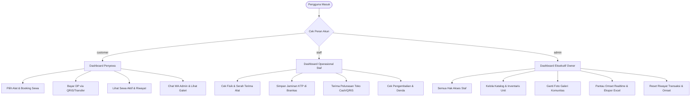
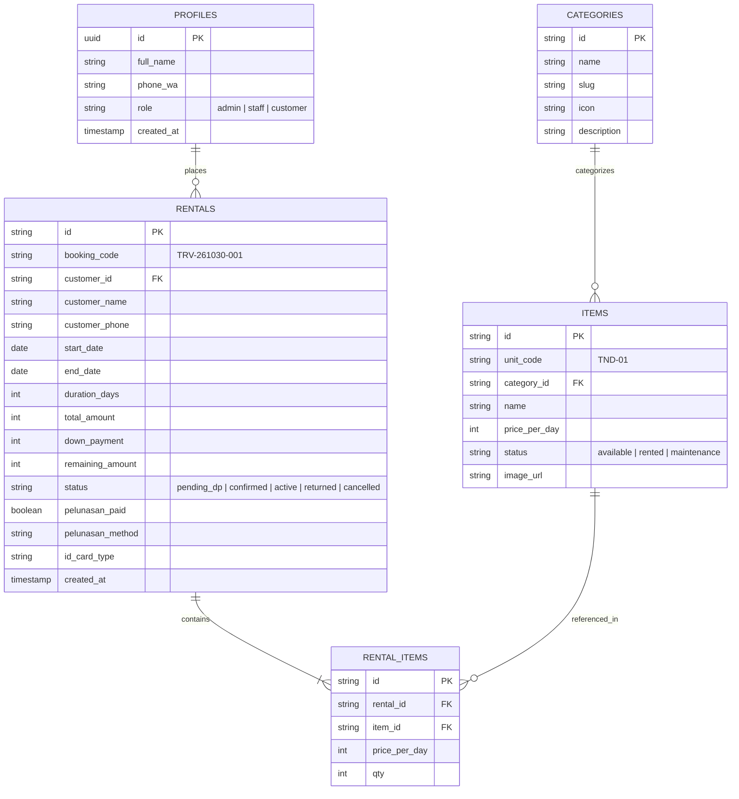

# Product Requirement Document (PRD)
## TRIVA Outdoor Rental — Style on the Trail

---

| Dokumen | Product Requirement Document (PRD) |
| :--- | :--- |
| **Produk** | TRIVA Outdoor Rental Web & Mobile PWA |
| **Versi** | 2.1 (Production Ready) |
| **Status** | Approved & Deployed |
| **Owner / Lead Admin** | Rifki Apirin (`owner@triva.id`) |
| **Hotline WhatsApp** | 083851284143 (+62 838-5128-4143) |
| **Live Repository** | [GitHub: rifkiapirin-dev/triva-outdoor-rental](https://github.com/rifkiapirin-dev/triva-outdoor-rental) |
| **Platform Hosting** | Vercel Serverless Production |
| **Database** | Supabase (PostgreSQL + Realtime Sync) & Local Persistent Cache |

---

## 1. Executive Summary & Visi Produk

### 1.1 Latar Belakang Masalah
Industri persewaan alat pendakian dan berkemah tradisional kerap menghadapi kendala operasional:
1. **Risiko Kehilangan & Kerusakan Alat:** Tidak adanya standardisasi jaminan fisik (KTP asli) dan pencatatan serah-terima unit yang transparan.
2. **Pencatatan Keuangan Manual:** Kas DP (*Down Payment*), sisa pelunasan di toko, denda keterlambatan, dan riwayat omset sering bercampur tanpa rekonsiliasi yang rapi.
3. **Pemesanan Tidak Realtime:** Pelanggan kesulitan mengecek ketersediaan inventaris (*available, rented, maintenance*) sebelum datang ke toko.
4. **Citra Brand yang Usang:** Kurangnya sentuhan estetika, branding, dan galeri pendaki nyata (*User Generated Content*) yang membangun kepercayaan komunitas outdoor.

### 1.2 Solusi TRIVA Outdoor
TRIVA Outdoor Rental hadir sebagai platform **SaaS & Mobile PWA** terintegrasi dengan tagline **"Style on the Trail"**. Menggabungkan katalog interaktif premium, sistem booking bersyarat DP minimal 30%, verifikasi jaminan KTP fisik di brankas toko, pelunasan sisa sewa saat serah-terima alat (*handover settlement*), customer service instan via WhatsApp, dan dashboard keuangan eksekutif dengan kemampuan export data dan reset omset.

---

## 2. User Persona & Matriks Hak Akses (RBAC)

Aplikasi memiliki 3 (tiga) peran pengguna terpisah secara ketat:

### 2.1 Matriks Peran & Izin

| Fitur / Modul | Tamu (Guest) | Penyewa (Customer) | Staf Operasional | Admin / Owner (Rifki) |
| :--- | :---: | :---: | :---: | :---: |
| Jelajah Katalog & Carousel Showcase | ✅ | ✅ | ✅ | ✅ |
| Masuk Keranjang & Booking Sewa Baru | ❌ (Harus Login) | ✅ | ✅ | ✅ |
| Bayar DP (Min. 30%) via QRIS / Transfer | ❌ | ✅ | ✅ | ✅ |
| Pelunasan Sisa Biaya di Toko saat Serah Terima | ❌ | ❌ (Hanya Mengetahui) | ✅ | ✅ |
| Akses Menu "Sewa Saya" (Pesanan Aktif) | ❌ | ✅ | ✅ | ✅ |
| Akses Menu "Riwayat Transaksi" (Arsip Selesai) | ❌ | ✅ | ✅ | ✅ |
| Cetak Nota / Struk Digital | ❌ | ✅ | ✅ | ✅ |
| Widget WhatsApp Mengambang CS | ✅ | ✅ | ✅ | ✅ |
| Ubah Foto & Cerita Galeri Komunitas | ❌ | ❌ | ❌ | ✅ (Khusus Admin) |
| Tambah / Edit / Hapus Master Unit Alat | ❌ | ❌ | ❌ | ✅ (Khusus Admin) |
| Laporan Keuangan, Omset, dan Ekspor CSV/Excel | ❌ | ❌ | ❌ | ✅ (Khusus Admin) |
| Reset Seluruh Transaksi & Omset Toko ke Rp 0 | ❌ | ❌ | ❌ | ✅ (Khusus Admin) |

---

## 3. Fitur Utama & Spesifikasi Fungsional (FR)

### FR-1: Katalog Inventaris Unit & Manajemen Stok
- Setiap alat memiliki kode unit spesifik (misal: `TND-01`, `CR-01`, `SPT-02`) dengan status:
  - `available`: Siap disewa.
  - `rented`: Sedang dibawa pendaki di lapangan.
  - `maintenance`: Dalam perawatan/cuci/reparasi.
- Kategori utama: Tenda, Carrier, Sepatu, Pakaian/Jaket, Alat Masak, Aksesoris & Lampu.
- Tampilan responsif dengan filter pencarian instan dan kategori tombol filter cepat.

### FR-2: Alur Pemesanan (Booking Flow) & Pembayaran DP
- Pelanggan memilih rentang tanggal sewa (misal: 3 hari pendakian akhir pekan).
- Sistem menghitung otomatis:
  $$\text{Total Biaya} = \sum (\text{Harga per Hari} \times \text{Durasi Hari} \times \text{Jumlah Unit})$$
  $$\text{Minimal DP} = \text{Total Biaya} \times 30\%$$
  $$\text{Sisa Pelunasan} = \text{Total Biaya} - \text{Nominal DP}$$
- Pembayaran DP dapat dilakukan via **QRIS Instan** dengan batas waktu 15 menit atau Transfer Bank.
- Syarat wajib: Penyewa menyetujui penyerahan jaminan fisik (KTP/SIM/KTM asli) saat pengambilan alat.

### FR-3: Serah Terima Fisik & Pelunasan di Toko (*Handover Settlement*)
- **Aturan Bisnis:** Jika penyewa membayar DP (tidak lunas di awal), sisa pembayaran wajib dilunasi saat serah terima barang langsung di toko/basecamp TRIVA.
- Staf / Admin membuka modal serah terima:
  - Memverifikasi kesesuaian fisik KTP/SIM dengan wajah penyewa.
  - Memilih metode pelunasan sisa tagihan: **Tunai (Cash)**, **QRIS Toko**, atau **Transfer Bank**.
  - Menyimpan KTP asli ke dalam brankas toko.
  - Menyerahkan unit alat yang telah diinspeksi.
  - Status sewa berganti menjadi `active` (Sedang Disewa).

### FR-4: Pemisahan Menu "Sewa Saya" vs "Riwayat Transaksi"
Untuk mencegah kebingungan pengguna, alur navigasi dipisahkan:
1. **Sewa Saya (Active View):** Menampilkan pesanan yang sedang berjalan (`pending_dp`, `confirmed`, `active`). Dilengkapi hitung mundur pengembalian dan rincian sisa tagihan yang harus dilunasi di toko.
2. **Riwayat Transaksi (History View):** Arsip transaksi masa lalu yang statusnya sudah `returned` (Selesai Dikembalikan) atau `cancelled` (Dibatalkan). Dilengkapi tombol cetak nota digital ulang.

### FR-5: Widget WhatsApp Admin Mengambang (*Floating CS*)
- Terpasang secara global di semua halaman pada posisi ergonomis (`bottom-20 right-4` di HP agar tidak menutupi navigasi bawah, dan `bottom-6 right-6` di desktop).
- Badge status hijau berdenyut (*Online CS*).
- Menyediakan *Quick Chips* keluhan/pertanyaan:
  - *"Konfirmasi Pembayaran DP / Pelunasan"*
  - *"Kendala Serah Terima Alat"*
  - *"Tanya Ketersediaan / Booking Khusus"*
  - Kolom ketik pesan custom bebas.
- Langsung membuka tautan resmi: `https://wa.me/6283851284143` dengan pesan pembuka rapi dan terformat.

### FR-6: Galeri Komunitas #StyleOnTheTrail Khusus Admin
- Galeri foto estetik pendaki asli di gunung-gunung Indonesia (Gn. Gede, Gn. Sagara, Gn. Papandayan, Gn. Cikuray, Gn. Prau, dll.).
- **Hak Akses:** Tombol "Ganti Foto" hanya muncul jika login sebagai role `admin`. Tamu dan penyewa hanya dapat melihat foto dan memberi *Like*.
- **Penyimpanan Berlapis (Anti-Reset):**
  - **Kompresi Otomatis:** Foto kamera HP (3MB–10MB) otomatis dikompres via HTML5 Canvas menjadi format JPEG ramah memori (~80KB - 120KB) dengan resolusi maksimal 1000px.
  - **Storage:** Disimpan simultan ke `localStorage`, `IndexedDB` (kapasitas ratusan MB), dan file server [`src/data/custom_ugc_photos.json`](file:///C:/Users/Admin/.gemini/antigravity/scratch/triva-outdoor-rental/src/data/custom_ugc_photos.json).
  - Foto tetap bertahan dan tidak pernah kembali ke bawaan saat halaman di-refresh.

### FR-7: Dashboard Eksekutif & Reset Omset Toko
- Metrik finansial realtime: Total Akumulasi Omset, Total Kas DP Diterima, Sisa Tagihan di Lapangan, Tingkat Utilisasi Alat (%), dan Peringatan Keterlambatan (*Overdue Alert*).
- Fitur ekspor laporan transaksi ke file Excel / CSV dengan 1 klik.
- **Tombol "Reset Omset & Transaksi":** Khusus Admin untuk membersihkan seluruh data transaksi demo/uji coba menjadi Rp 0, mengembalikan status seluruh alat menjadi "Tersedia", dan mengosongkan tabel transaksi.

---

## 4. Persyaratan Non-Fungsional (NFR)

| Kategori | Spesifikasi & Standar |
| :--- | :--- |
| **PWA (Progressive Web App)** | Memiliki `manifest.webmanifest`, ikon resolusi 192x192 & 512x512, tema warna `#851919`, mode `standalone` (tampilan aplikasi layar penuh tanpa address bar browser). |
| **Instalasi Mobile** | Dilengkapi banner shortcut otomatis *"📲 Install Aplikasi TRIVA"* untuk Android (Chrome) dan panduan modal 2 langkah untuk iPhone (Safari). |
| **Performa & Kecepatan** | *First Load JS* di bawah 225 KB per rute, generasi halaman statis (14/14 static routes), skor Lighthouse > 90. |
| **Penyimpanan & Kuota** | Proteksi `QuotaExceededError` dengan kompresi gambar client-side dan fallback IndexedDB. |
| **Database & Sinkronisasi** | Terhubung ke Supabase Cloud (PostgreSQL + Auth + Realtime), dengan fallback demo lokal mandiri tanpa ketergantungan internet mati. |
| **Keamanan Data** | Validasi role RBAC di komponen antarmuka, enkripsi password via Supabase Auth, perlindungan parameter rute menggunakan `<Suspense>` boundary. |

---

## 5. Arsitektur Data & Skema Database

---

## 6. Tech Stack & Deployment

- **Framework:** Next.js 15.5 (App Router, React 19, TypeScript)
- **Styling:** Tailwind CSS 3.4, Lucide React Icons
- **PWA & Offline:** HTML5 Canvas Compression, IndexedDB API, Web App Manifest
- **Backend & Auth:** Supabase Auth, Supabase Database (PostgreSQL), Supabase Realtime Channels
- **Deployment Platform:** Vercel Production Serverless
- **Version Control:** Git & GitHub (`main` branch automated CI/CD)
